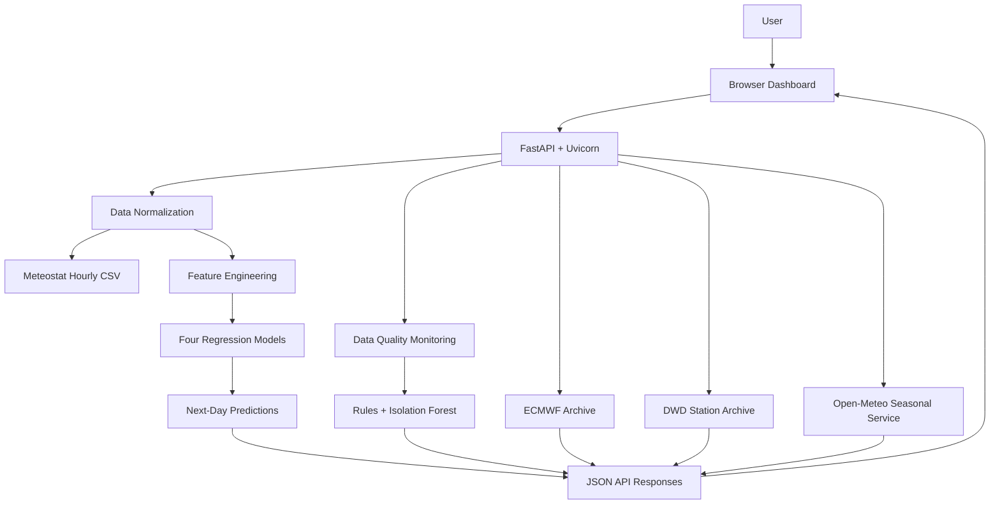

# 🌦️ AtmosIQ — Where Weather Meets Intelligence

**An interactive weather analytics and data-quality monitoring platform powered by Python, machine learning, and weather datasets.**

AtmosIQ brings together historical weather data, city-level weather conditions, anomaly detection, and next-day temperature and humidity predictions in one dashboard.

The goal is simple: make weather data easier to explore, understand, and evaluate.

> **What makes AtmosIQ useful?** It doesn't just display weather information. It also helps identify suspicious data, explore historical patterns, compare different weather data sources, and understand what machine-learning models can predict.

---

## 📌 Table of Contents

- [1. Project Overview](#-1-project-overview)
- [2. The Problem](#-2-the-problem)
- [3. Our Solution](#-3-our-solution)
- [4. Key Features](#-4-key-features)
- [5. Technology Stack](#-5-technology-stack)
- [6. System Architecture](#-6-system-architecture)
- [7. Understanding the Data](#-7-understanding-the-data)
- [8. Machine Learning Explained](#-8-machine-learning-explained)
- [9. Project Structure](#-9-project-structure)
- [10. Getting Started](#-10-getting-started)
- [11. Running AtmosIQ](#-11-running-atmosiq)
- [12. Exploring the API](#-12-exploring-the-api)
- [13. Training the Models](#-13-training-the-models)
- [14. Running Tests](#-14-running-tests)
- [15. Configuration](#-15-configuration)
- [16. Troubleshooting](#-16-troubleshooting)
- [17. Limitations and Security](#-17-limitations-and-security)
- [18. Future Improvements](#-18-future-improvements)
- [19. Contributing](#-19-contributing)
- [20. License and Data Attribution](#-20-license-and-data-attribution)

---

## 🌍 1. Project Overview

AtmosIQ is a weather analytics and decision-support prototype focused on Germany.

It combines multiple weather data sources with a machine-learning pipeline to help users explore weather conditions, identify unusual readings, and investigate patterns in historical data.

The project is designed for students, developers, data analysts, and anyone interested in understanding how weather data and machine learning can work together.

### What can you do with AtmosIQ?

- Explore weather conditions through an interactive dashboard.
- View historical weather trends and daily summaries.
- Identify potentially unusual or suspicious weather readings.
- Generate next-day estimates for temperature and relative humidity.
- Explore city-level weather conditions and illustrative alerts.
- Compare station observations with gridded weather estimates.
- Inspect model evaluation metrics and export chart data.
- Explore optional seasonal outlooks when the external provider is available.

### Project at a glance

| Component | Description |
|---|---|
| Project name | AtmosIQ |
| Tagline | Where Weather Meets Intelligence |
| Application type | Weather analytics and decision support |
| Backend | Python, FastAPI, Uvicorn |
| Frontend | HTML, CSS, JavaScript |
| Machine learning | scikit-learn |
| Data storage | CSV files and model artifacts |
| API documentation | FastAPI Swagger UI |
| Primary geographical focus | Germany |
| Database | No database included in the supplied project |

**Important:** The internal Python package is named `climate_guard`. This is a legacy package name used by the application.

---

## 🎯 2. The Problem

Weather datasets are useful, but working with them is not always straightforward.

Data collected from different sources may contain missing measurements, suspicious spikes, inconsistent timestamps, or differences caused by how and where the data was collected.

For example:

- A weather station may report a temperature that differs sharply from surrounding observations.
- Missing hourly readings may affect daily summaries.
- Historical observations and gridded weather estimates may not represent exactly the same conditions.
- Machine-learning predictions may look convincing even when their evaluation has important limitations.
- Weather information spread across multiple datasets can be difficult to explore in one place.

These challenges can make weather analysis harder and reduce confidence in the conclusions drawn from the data.

## 💡 3. Our Solution

AtmosIQ brings several weather-data workflows together in a single application.

The backend processes weather records, prepares model inputs, generates predictions, performs data-quality checks, and exposes the results through an API. The browser dashboard presents those results in a more accessible form.

The application has four main areas:

1. **Weather exploration** — understand historical and city-level weather conditions.
2. **Data-quality monitoring** — flag potentially suspicious readings for further investigation.
3. **Machine-learning predictions** — estimate the next day's temperature and humidity extremes.
4. **Model and data evaluation** — inspect model metrics, data coverage, and source information.

Instead of treating every result as unquestionable truth, AtmosIQ aims to make the data, predictions, and their limitations easier to inspect.

---

## ✨ 4. Key Features

### 🗺️ Interactive Weather Dashboard

Explore weather information through a browser-based interface featuring maps, weather panels, alerts, historical views, and model metrics.

The map uses Leaflet and OpenStreetMap tiles when online map resources are available. A schematic fallback is documented for situations where map resources cannot load.

### 📈 Historical Weather Explorer

Explore daily weather summaries derived from the bundled ECMWF IFS gridded archive.

Historical views help users investigate how selected weather measurements change over time.

### 🤖 Next-Day Weather Prediction

AtmosIQ uses four independent regression models to estimate:

- Daily minimum temperature.
- Daily maximum temperature.
- Daily minimum relative humidity.
- Daily maximum relative humidity.

The forecasting pipeline uses historical hourly readings to build features and generate predictions for the next calendar day.

### 🔎 Weather Data Quality Monitoring

The quality-monitoring pipeline combines rule-based checks, time-segment analysis, and an Isolation Forest anomaly-detection model.

It can flag suspicious readings and return findings containing information such as the type of issue, severity, and supporting evidence where available.

These findings are intended to support investigation, not automatically prove that a measurement is incorrect.

### 🚨 City-Level Conditions and Alerts

AtmosIQ aggregates bundled German Weather Service (DWD) station observations into city-level conditions and applies illustrative thresholds to identify potentially noteworthy situations.

The thresholds are screening rules, not official weather warnings.

### 🌐 Seasonal Outlook

An optional feature requests monthly seasonal outlook information from Open-Meteo's ECMWF SEAS5 service.

The application summarizes monthly anomalies across nine sample locations. This is a rough spatial overview, not a calibrated, location-specific probability forecast.

Network or provider failures may cause this feature to return an unavailable response.

### 📊 Model Evaluation and Export

Inspect saved model evaluation metadata, including regression metrics and tolerance-hit rates.

The project also includes scripts for exporting evaluation reports and holdout predictions to CSV files.

### 🧰 Developer and Maintenance Tools

The repository includes tools for:

- Training the models.
- Running automated tests.
- Exploring additional model candidates.
- Refreshing recent DWD data.
- Building weather archives.
- Comparing model predictions with station observations.

---

## 🛠️ 5. Technology Stack

| Technology | How AtmosIQ uses it |
|---|---|
| Python 3.13 | Backend logic, data processing, and machine learning |
| FastAPI | Builds the web API and serves the dashboard |
| Uvicorn | Runs the Python web application |
| Pydantic | Validates incoming API requests |
| pandas | Loads, cleans, and transforms weather datasets |
| NumPy | Supports numerical calculations |
| scikit-learn 1.8.0 | Regression models, evaluation, preprocessing, and anomaly detection |
| joblib | Saves and loads trained model artifacts |
| HTML, CSS, JavaScript | Builds the browser interface |
| Leaflet | Displays interactive maps |
| OpenStreetMap | Supplies online map tiles |
| pytest | Runs automated tests |
| HTTPX | Supports API testing |
| Docker Compose | Provides an optional container-based setup |

The supplied frontend consists of static files. No npm installation or frontend build command is required.

---

## 🏗️ 6. System Architecture

AtmosIQ follows a straightforward architecture: the browser requests information from a Python backend, the backend processes the relevant data, and the browser displays the response.

### Architecture diagram



### How the application works

1. The user opens the dashboard in a browser.
2. FastAPI serves the frontend and exposes API endpoints.
3. An endpoint loads the relevant dataset, metadata, or saved model.
4. The backend validates and processes the input.
5. The requested operation runs, such as a forecast, quality scan, or historical aggregation.
6. The backend returns the result as JSON.
7. The dashboard displays the result to the user.

The application uses CSV files and saved model artifacts as its primary persistent resources. No database engine is included in the supplied package.

---

## 🌦️ 7. Understanding the Data

AtmosIQ uses three distinct weather-data assets. Understanding their differences is important because they serve different purposes.

### 7.1 Meteostat-derived hourly data

**File:** `data/meteostat_2024.csv`

This is the default dataset used by the four-model next-day forecasting pipeline and the original dataset summary.

It contains hourly weather measurements from 2024. The supplied tests expect 8,784 rows and 432 missing temperature readings.

The application normalizes its columns and timestamps before using the data for forecasting or quality checks.

### 7.2 ECMWF IFS gridded archive

**File:** `data/reanalysis_hourly_2024_2026.csv`

This archive contains hourly gridded weather estimates for nine sample cities, with accompanying metadata.

It supports historical weather exploration and the separate city-level forecast layer.

Gridded estimates represent modeled atmospheric conditions over a spatial grid. They should not be treated as identical to direct station observations.

### 7.3 DWD station observations

**File:** `data/dwd_station_observations_2024_2026.csv`

This archive contains weather observations from German Weather Service stations.

It supports city-level weather conditions, station summaries, station comparisons, and illustrative threshold alerts.

The bundled archive is documented through October 16, 2026. Its 2026 values are marked as provisional in the supplied project documentation.

### Why are these datasets separate?

Each source has its own measurement context, coverage, and limitations.

| Dataset | Primary purpose | Data type |
|---|---|---|
| Meteostat-derived CSV | Default next-day model pipeline | Hourly weather records |
| ECMWF IFS archive | Historical exploration and city forecast layer | Gridded weather estimates |
| DWD archive | Station conditions and illustrative alerts | Station observations |

These datasets are not interchangeable, and the ECMWF archive is not automatically merged into the original model-training CSV.

**A note about freshness:** The bundled 2024 dataset is historical, not a live feed. A next-day forecast must have enough recent observations and a complete latest day. Updating the DWD archive does not automatically update the separate default forecast input.

---

## 🧠 8. Machine Learning Explained

You do not need a machine-learning background to understand the basic forecasting workflow.

### Step 1: Prepare the weather data

The application loads hourly weather records and validates the required measurement columns and timestamps.

Invalid timestamps and duplicate timestamps are rejected. Invalid measurement strings are converted to missing values so that downstream quality checks can investigate them.

### Step 2: Build useful features

The feature-engineering module creates information that can help a model make a prediction.

Examples include:

- Previous days' weather measurements.
- Lagged weather features.
- Calendar features representing recurring time patterns.

The tests include checks intended to prevent information from the target day leaking into its own prediction features.

### Step 3: Train four regression models

AtmosIQ trains four separate models rather than one model predicting all four targets together.

The candidate pool includes persistence baselines, Ridge regression, Random Forest, Extra Trees, and HistGradientBoosting.

Candidate selection uses forward-chaining validation within the training period. A non-persistence candidate must satisfy the project's improvement criteria before it is selected.

### Step 4: Evaluate the models

The project records regression metrics, including:

- **MAE:** Mean Absolute Error, the average absolute difference between predictions and actual values.
- **RMSE:** Root Mean Squared Error, which penalizes larger errors more strongly.
- **R²:** A measure of model performance relative to a mean-prediction baseline.
- **Tolerance-hit rate:** The percentage of predictions that fall within a specified error tolerance.

The project's `accuracy_pct` field represents a tolerance-hit rate, **not conventional classification accuracy**.

### Step 5: Generate the next-day estimates

The forecasting endpoint checks the available history, validates the requested date, loads the saved model bundles, and checks the runtime scikit-learn version against the saved metadata.

The forecast must target exactly the next calendar day. The input must contain at least eight days of hourly records, and the latest observed day must contain 24 rows.

Humidity predictions are clipped to the range from 0 to 100.

### An important note about model performance

The supplied documentation states that the retrospective holdout was examined during earlier model iterations. Consequently, the reported metrics are exploratory rather than independent evidence of future forecasting performance.

Evaluating the models on a genuinely untouched future period would provide stronger evidence of how well they generalize.

---

## 📁 9. Project Structure

The following tree summarizes the main directories and files included in the supplied project archive.

```text
atmosiq_project/
│
├── README.md
├── requirements.txt
├── requirements-optimization.txt
├── Dockerfile
├── compose.yaml
├── .env.example
│
├── climate_guard/
│   ├── api.py
│   ├── data.py
│   ├── features.py
│   ├── modelling.py
│   ├── qc.py
│   ├── map_data.py
│   ├── city_forecast.py
│   ├── seasonal.py
│   ├── advanced_features.py
│   ├── train_all.py
│   └── models/
│       ├── low_temperature.py
│       ├── high_temperature.py
│       ├── low_humidity.py
│       └── high_humidity.py
│
├── data/
│   ├── meteostat_2024.csv
│   ├── reanalysis_hourly_2024_2026.csv
│   ├── reanalysis_hourly_2024_2026.metadata.json
│   ├── dwd_station_observations_2024_2026.csv
│   └── dwd_station_observations.metadata.json
│
├── artifacts/
│   ├── low_temperature.joblib
│   ├── high_temperature.joblib
│   ├── low_humidity.joblib
│   ├── high_humidity.joblib
│   ├── quality_isolation_forest.joblib
│   ├── metrics_summary.json
│   └── [model reports and evaluation files]
│
├── frontend/
│   ├── index.html
│   ├── app.js
│   ├── dashboard.js
│   ├── dashboard.css
│   ├── history.js
│   ├── map.js
│   └── style.css
│
├── examples/
│   ├── 2024_demo_next_day_response.json
│   ├── 2024_example_sensor_quality.json
│   └── seasonal_outlook_MOCK_NOT_REAL.json
│
├── reports/
│   ├── model_metrics.csv
│   ├── holdout_predictions.csv
│   └── [additional reports and logs]
│
├── scripts/
│   ├── build_dwd_archive.py
│   ├── refresh_dwd_recent.py
│   └── validate_models_vs_dwd.py
│
├── tests/
│   ├── test_pipeline.py
│   ├── test_map_data.py
│   └── test_export_metrics.py
│
├── export_model_metrics.py
├── experiment_search.py
└── train_reanalysis.py
```

### Important files to know

| File | Responsibility |
|---|---|
| `climate_guard/api.py` | Defines API routes and serves the dashboard |
| `climate_guard/data.py` | Validates and normalizes weather data |
| `climate_guard/features.py` | Creates features and daily target labels |
| `climate_guard/modelling.py` | Trains, evaluates, and runs the four forecasting models |
| `climate_guard/qc.py` | Performs weather-data quality checks |
| `climate_guard/map_data.py` | Builds city conditions and threshold alerts |
| `climate_guard/city_forecast.py` | Generates city-level forecast estimates |
| `climate_guard/seasonal.py` | Integrates the optional seasonal outlook provider |
| `climate_guard/train_all.py` | Trains the target models and quality model |
| `frontend/` | Contains the browser dashboard |
| `data/` | Contains weather datasets and metadata |
| `artifacts/` | Contains trained models and saved evaluation information |
| `tests/` | Contains automated tests |
| `scripts/` | Contains data maintenance and validation tools |

---

## 🚀 10. Getting Started

This section walks you through running AtmosIQ on your own computer.

You can run the project locally using Python. Docker is available as an alternative.

### Prerequisites

Before starting, make sure you have:

- Python 3.13, recommended by the supplied README and Dockerfile.
- A terminal application.
- The extracted project directory.
- An internet connection for installing dependencies and accessing optional online features.
- Enough disk space for the datasets, artifacts, and virtual environment.

Git is only required if you want to clone the repository. If you already have the supplied ZIP file, you can work directly from the extracted folder.

### Step 1: Obtain the project

If you are using the supplied ZIP, extract it into a directory of your choice.

On macOS or Linux:

```bash
unzip atmosiq_project.zip -d atmosiq_project
cd atmosiq_project
```

On Windows, extract the ZIP using File Explorer and open PowerShell in the extracted project directory.

Check that the directory contains files such as:

```text
README.md
requirements.txt
climate_guard/
frontend/
data/
artifacts/
```

**Important:** Run the following commands from the project root, not from inside `climate_guard/` or `frontend/`.

### Step 2: Create a virtual environment

A virtual environment keeps the project's Python dependencies separate from other Python projects on your computer.

On macOS or Linux:

```bash
python3.13 -m venv .venv
source .venv/bin/activate
```

On Windows PowerShell:

```powershell
py -3.13 -m venv .venv
.\.venv\Scripts\Activate.ps1
```

If PowerShell blocks script activation, follow the appropriate Python and PowerShell guidance for your system rather than changing security settings blindly.

### Step 3: Verify Python

With the virtual environment activated, run:

```bash
python --version
python -m pip --version
```

Confirm that the active Python interpreter is the one you intend to use.

### Step 4: Install the dependencies

Run these commands from the project root:

```bash
python -m pip install --upgrade pip
python -m pip install -r requirements.txt
```

The requirements file installs the packages needed by the application, including FastAPI, Uvicorn, pandas, NumPy, scikit-learn, joblib, pytest, and HTTPX.

The project pins scikit-learn to version 1.8.0. Keep that version aligned with the supplied model artifacts unless you deliberately retrain and validate them.

### Step 5: Verify the project assets

Make sure the extracted `data/` and `artifacts/` directories contain the required files.

The main forecasting features require:

- `data/meteostat_2024.csv`
- `artifacts/low_temperature.joblib`
- `artifacts/high_temperature.joblib`
- `artifacts/low_humidity.joblib`
- `artifacts/high_humidity.joblib`

The model metrics endpoint also requires the corresponding JSON reports. Quality monitoring requires the saved quality-model artifact, while historical and map features require their respective datasets and metadata.

Do not move these files without updating the relevant configuration.

---

## ▶️ 11. Running AtmosIQ

Once the dependencies are installed and the virtual environment is active, start the application from the project root.

### Start the backend

On macOS, Linux, or Windows:

```bash
python -m uvicorn climate_guard.api:app --host 127.0.0.1 --port 8000
```

The terminal should show that the server has started. Keep this terminal open while using the application.

### Open the dashboard

Visit the following address in your browser:

**http://127.0.0.1:8000/**

You should be able to access the dashboard if the application starts successfully.

### Explore the API documentation

FastAPI automatically provides an interactive API documentation page:

**http://127.0.0.1:8000/docs**

This page lets you inspect available endpoints, view their expected inputs, and try requests.

### Check application readiness

Open:

**http://127.0.0.1:8000/api/v1/health**

The health endpoint checks whether the configured CSV and four forecasting model files are present.

A `ready` status indicates that those required assets are available. It does not guarantee that every optional feature or external service is working.

### Stop the application

Return to the terminal where Uvicorn is running and press:

```text
Ctrl + C
```

---

## 🐳 Optional: Run with Docker

Docker provides another way to run the application without manually creating the project's Python virtual environment on your host.

You need Docker Engine and the Docker Compose plugin installed.

From the project root, run:

```bash
docker compose up --build
```

Open the dashboard at:

http://127.0.0.1:8000/

To stop the containers, press `Ctrl + C` or run:

```bash
docker compose down
```

The initial build may take longer on architectures that need to compile scientific dependencies.

Avoid adding `-v` to the cleanup command unless you understand the effects on any Docker volumes.

---

## 🔌 12. Exploring the API

The API allows the dashboard and other clients to interact with the weather-processing and machine-learning features.

The following routes are among the main endpoints included in the supplied project.

| Method | Endpoint | Purpose |
|---|---|---|
| GET | `/api/v1/health` | Checks required asset readiness |
| GET | `/api/v1/dataset/summary` | Summarizes the original dataset |
| GET | `/api/v1/models/metrics` | Returns saved model evaluation metadata |
| GET / POST | `/api/v1/forecast/next-day` | Generates a next-day forecast |
| GET | `/api/v1/forecast/cities` | Returns city-level forecast estimates |
| GET / POST | `/api/v1/quality/scan` | Scans weather records for potential quality issues |
| GET | `/api/v1/weather/history/summary` | Summarizes historical ECMWF data |
| GET | `/api/v1/weather/history/daily` | Returns daily historical weather data |
| GET | `/api/v1/weather/map` | Returns city conditions for a date |
| GET | `/api/v1/weather/alerts` | Returns threshold alerts over a date window |
| GET | `/api/v1/outlook/locations` | Lists seasonal outlook sample locations |
| GET | `/api/v1/outlook/next-month` | Requests the automatic next-month outlook |
| GET | `/api/v1/outlook/month` | Requests an outlook for a specified future month |
| GET | `/docs` | Opens the Swagger API explorer |

Additional endpoints support station summaries, daily station data, comparisons, and model validation. Consult `/docs` for their exact query parameters and request schemas.

### Quick API checks

With the server running, you can use these addresses to verify different parts of the application:

```text
http://127.0.0.1:8000/api/v1/health
http://127.0.0.1:8000/api/v1/dataset/summary
http://127.0.0.1:8000/api/v1/models/metrics
http://127.0.0.1:8000/api/v1/weather/history/summary
http://127.0.0.1:8000/api/v1/outlook/locations
```

For POST requests, use the schemas shown in `/docs`. The forecasting endpoint accepts batches of 192–25,000 records; quality scanning accepts 1–25,000 records. These limits apply to submitted batches, not to the number of rows in the bundled CSV.

---

## 🧪 13. Training the Models

The supplied archive includes saved models, so **you do not need to retrain them just to start the application**.

If you want to experiment with model training, first activate the virtual environment and return to the project root.

Run:

```bash
python -m climate_guard.train_all \
  --data data/meteostat_2024.csv \
  --output artifacts
```

This workflow trains the four forecasting models and the Isolation Forest quality model, saves model artifacts, and writes evaluation summaries.

**Warning:** Training can overwrite existing files in the selected output directory. Back up the current artifacts before running it.

### Export model evaluation reports

To regenerate the model evaluation reports, run:

```bash
python export_model_metrics.py
```

Review the generated reports before replacing any existing evaluation results.

### Optional optimization experiments

The repository also contains `experiment_search.py` for broader candidate exploration. It is not required to run the API, and the supplied documentation states that LightGBM, XGBoost, and CatBoost must be installed separately if the relevant experiments are used.

---

## ✅ 14. Running Tests

Automated tests help check whether the application behaves as expected after a code change.

With the virtual environment active, run:

```bash
python -m pytest -q
```

The supplied tests cover data normalization, feature engineering, leakage prevention, forecasting, quality checks, map alerts, API behavior, seasonal parsing, and report generation.

### Known test issue in the supplied archive

The documented test run produced:

- **13 passed**
- **1 failed**

The failing test is:

`tests/test_export_metrics.py::test_report_has_four_models_and_holdout_predictions`

The test expects 282 holdout-detail rows, while the supplied exporter produced 7,308 rows in that run.

This discrepancy should be investigated before changing the test expectation or exporter behavior. It is a documented result from the supplied environment, not a guarantee that every future run will produce the same counts.

---

## ⚙️ 15. Configuration

AtmosIQ can be configured through environment variables.

The `.env.example` file documents the available settings, but the application does not automatically load that file. Set the variables in your shell or process manager instead.

| Variable | Default | Purpose |
|---|---|---|
| `CLIMATEGUARD_DATA_PATH` | `data/meteostat_2024.csv` | Selects the original hourly CSV |
| `CLIMATEGUARD_MODEL_DIR` | `artifacts` | Selects the model and quality-artifact directory |
| `CORS_ALLOW_ORIGINS` | Empty | Specifies trusted browser origins for CORS |
| `OPEN_METEO_API_KEY` | Unset | Optional provider key for seasonal outlook requests |

### macOS and Linux

```bash
export CLIMATEGUARD_DATA_PATH=data/meteostat_2024.csv
export CLIMATEGUARD_MODEL_DIR=artifacts
export CORS_ALLOW_ORIGINS=http://localhost:5173,http://localhost:3000
```

If you need an Open-Meteo API key for your provider setup:

```bash
export OPEN_METEO_API_KEY="your-provider-key"
```

### Windows PowerShell

```powershell
$env:CLIMATEGUARD_DATA_PATH = "data/meteostat_2024.csv"
$env:CLIMATEGUARD_MODEL_DIR = "artifacts"
$env:CORS_ALLOW_ORIGINS = "http://localhost:5173,http://localhost:3000"
```

Optional provider configuration:

```powershell
$env:OPEN_METEO_API_KEY = "your-provider-key"
```

Use actual credentials only in your local environment. Never commit real API keys or other secrets to GitHub.

For the bundled dashboard served from the same origin, custom CORS configuration is generally unnecessary.

---

## 🧯 16. Troubleshooting

Here are common problems you might encounter when running the project.

| Problem | Likely cause | What to do |
|---|---|---|
| `python3.13` is not found | Python 3.13 is not installed or not on PATH | Install Python 3.13 and verify the interpreter |
| `No module named fastapi` | Dependencies are missing or the virtual environment is inactive | Activate `.venv` and install `requirements.txt` |
| `No module named climate_guard` | Command was run from the wrong directory | Change to the project root |
| Port 8000 is already in use | Another process is using the port | Stop that process or use another port and URL |
| Health status is `setup_required` | A required CSV or model file is missing or misconfigured | Check the assets and environment variables |
| Forecast returns HTTP 422 | The date, data schema, or history does not satisfy validation | Check the request in `/docs` |
| Forecast history is insufficient | Fewer than eight days of rows or an incomplete latest day | Supply enough valid hourly history |
| scikit-learn version mismatch | Runtime version differs from saved model metadata | Restore the compatible version or retrain and validate trusted artifacts |
| Seasonal outlook returns HTTP 503 | Network or external provider is unavailable | Retry later; local features may still work |
| Map tiles do not load | The network, CDN, or OpenStreetMap tiles are unavailable | Check connectivity and look for the schematic fallback |
| Docker build fails on s390x | A dependency wheel or compiler prerequisite may be missing | Inspect build logs and supported native build requirements |
| Exporter test fails | Expected and actual holdout-detail row counts disagree | Inspect the exporter and test before changing either |

### Still stuck?

Start by checking these three things:

1. Are you in the directory containing `requirements.txt` and `climate_guard/`?
2. Is the correct virtual environment active?
3. Are the required data files and saved model artifacts present?

If the problem continues, inspect the terminal error and the relevant endpoint response.

---

## 🔐 17. Limitations and Security

AtmosIQ is a prototype for weather analysis and decision support. It should not be treated as an official forecasting or emergency-warning service.

### Data and model limitations

- Bundled datasets are snapshots, not continuously updated live feeds.
- The default next-day forecast depends on the configured hourly CSV and sufficiently recent, complete observations.
- DWD station observations and ECMWF gridded estimates have different meanings and should remain clearly identified.
- The 2026 DWD archive values are provisional according to the supplied documentation.
- Threshold alerts are illustrative screening rules, not official DWD warnings.
- Seasonal outlooks depend on an external provider and use a limited set of sample locations.
- Previously examined holdout results do not provide fully independent evidence of future model performance.
- A flagged observation may be unusual without being incorrect; findings should be investigated.

### Security considerations

The supplied application does not implement authentication or authorization.

Before making it available to other people:

- Keep it on a trusted private network or behind an appropriately secured access layer.
- Use an SSH tunnel or a TLS reverse proxy with authentication when remote access is required.
- Apply access controls and rate limiting for shared deployments.
- Store provider credentials in environment variables or a secrets manager.
- Load only trusted `.joblib` model artifacts because joblib uses pickle-based serialization.
- Validate uploaded data and review dependency vulnerabilities.

The default command binds to `127.0.0.1`, keeping the service on the local machine. Binding to `0.0.0.0` makes it listen on network interfaces and should only be done with suitable network restrictions and access controls.

---

## 🔮 18. Future Improvements

Possible areas for further development include:

1. **Independent model evaluation** — evaluate predictions on a genuinely untouched future period.
2. **Improved data validation** — strengthen checks for measurement ranges, gaps, and suspicious sensor behavior.
3. **Enhanced API security** — introduce authentication, access controls, and rate limiting.
4. **Dependency management** — add a dependency lock file and a verified platform support matrix.
5. **Testing improvements** — investigate the existing exporter test discrepancy and expand integration coverage.
6. **Better observability** — add structured logs and clearer error reporting.
7. **Data provenance** — make source attribution, timestamps, units, and quality caveats more visible in the interface and exports.
8. **Performance improvements** — investigate caching and efficient processing for larger weather archives.

These are potential improvements, not claims that the features are already implemented.

---

## 🤝 19. Contributing

Contributions, bug reports, and improvement suggestions are welcome.

If you want to contribute:

1. Review the existing code and understand the relevant data flow.
2. Create a separate branch for your changes.
3. Keep data validation and model features consistent with the existing input schema.
4. Add or update tests when changing behavior.
5. Run the test suite and inspect the results.
6. Update the documentation when adding endpoints, configuration, or dependencies.
7. Back up model artifacts before retraining or changing their format.

For model-related contributions, preserve chronological validation and avoid leaking future information into training features.

For data-source contributions, document provenance, units, time zones, coverage, and limitations.

---

## 📄 20. License and Data Attribution

The supplied project materials do not establish a definitive project-wide software license in this guide.

Before publishing or redistributing the repository, add an appropriate `LICENSE` file and verify the redistribution terms for the software and datasets involved.

Also preserve the relevant source attribution and licensing information for Meteostat-derived data, ECMWF products, DWD station observations, Open-Meteo services, and OpenStreetMap map tiles.

Refer to the original providers' terms for the applicable conditions.

---

## 🌦️ Final Note

AtmosIQ is built around a simple idea: **weather data becomes more useful when we can explore it, question its quality, and understand the limits of our predictions.**

Whether you're learning Python, exploring machine learning, working with environmental datasets, or building data-driven applications, AtmosIQ provides a practical project for investigating how these pieces fit together.

**AtmosIQ — Where Weather Meets Intelligence.**
